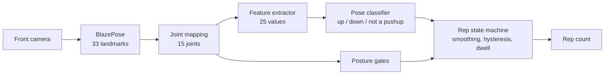

# PressPass

Press-ups are the pass. An iOS app that makes you earn time in distracting apps with pushups, verified on-device by the front camera.

Plenty of apps already do this. I used one, and two things about it bothered me: it credited time without ever deducting what I actually used, and it was easy to get around. Reviews of the others say much the same, and add a third complaint, which is that real reps often do not get counted. None of these apps publishes how accurate its counter is or how easily it can be fooled.

So this project is less about the app and more about measuring it properly: an open dataset, an evaluation that replays recorded sessions through the exact code that runs on the phone, and a table of which cheats get through.

> **Status: work in progress.** The pipeline, the recorder and the evaluation harness are built and tested. The dataset is still being recorded, so there are **no accuracy numbers yet**. The only results so far come from synthetic sessions that exercise the harness and say nothing about real accuracy.

## How it works

The phone sits on the floor facing you head-on. This is the awkward view for pose estimation (the body is foreshortened and the hips are mostly hidden), and it is the practical one, because it needs about a metre of floor instead of a whole room.



Everything from joint mapping onwards lives in a Swift package, `Packages/PushupCore`, with no dependency on the camera, MediaPipe or UIKit. The app feeds it live frames. The evaluation tool feeds it recorded ones. It is the same code either way, so there is no separate offline implementation that can drift from what ships.

## How it is evaluated

1. **Record.** A debug recorder saves each take as the raw landmark stream plus the phone's own motion, with condition tags (lighting, distance, clothing, tempo) and the number of valid reps as counted by the person. The app's count is hidden until that number has been saved, so the label cannot be influenced by it.
2. **Replay.** `pushup-eval` runs every recorded take through `PushupPipeline` and writes the predicted count, the time of each counted rep and how many frames each gate rejected.
3. **Report.** A small Python package computes exact-count accuracy, off-by-one accuracy, error in reps, signed bias, reps wrongly awarded to cheat takes, and false reps per minute on clips with no exercise in them. Confidence intervals come from a bootstrap over sittings, because takes recorded in one sitting are not independent.

The train and test split is fixed by sitting before any model is trained. Takes are never discarded because the app miscounted them.

Details: [recording protocol](docs/recording-protocol.md), [data format](docs/data-format.md), [metric definitions](docs/evaluation.md).

## What exists today

| Part | State |
|---|---|
| Pose pipeline and rep counter (`PushupCore`) | Built. Classifier is a hand-tuned elbow-angle heuristic; no trained model yet |
| Tests | 170 Swift tests and 44 Python tests |
| Swift and Python feature code agree | Checked on 99 poses, largest difference 2e-7 |
| Debug recorder with ground-truth counts | Built, not yet run on a device |
| Replay evaluation and report | Built, verified end to end on synthetic sessions only |
| Dataset | Not recorded yet |
| Screen Time blocking and per-minute metering | Written, never run on a device (it needs the paid Family Controls entitlement) |

## Known problems

Found by the tests, and left in place until there is real data to tune against:

- **Fast reps are dropped silently.** Each phase must last 0.5 s, so the counter cannot register more than one rep per second. Ten reps at 0.6 s each count as four. A separate rule meant to flag reps that come too quickly can never fire, because the dwell rule always gets there first.
- **The feature extractor needs the hips.** They are hard to see head-on from floor level. I expect this to cost frames; the recordings will show how many.

## Building

The Xcode project is generated, and the pose model comes through CocoaPods, in this order:

```sh
xcodegen generate
pod install
open PushupTime.xcworkspace
```

Use the `PushupTimeDev` scheme on a free developer account: it leaves out the Screen Time extensions and their entitlements. `MediaPipeTasksVision` is pinned to 0.10.21.

Run the tests and the evaluation without a phone:

```sh
swift test --package-path Packages/PushupCore
uv run --project eval pytest eval/tests
scripts/eval_synthetic.sh        # full pipeline on synthetic sessions
scripts/eval.sh                  # the real thing, once data/sessions has recordings
```

## Layout

```
App/                    SwiftUI app: camera session, workout screen, debug recorder
Packages/PushupCore/    Pose mapping, features, classifier, rep counter, session schema,
                        and the pushup-eval command-line tool
eval/                   Python report: metrics, bootstrap intervals, figures
data/sessions/          Recorded takes (empty for now)
docs/                   Protocol, data format, metric definitions
Shared/, *Extension/    Screen Time blocking and metering
training/               Earlier training scripts, due to be replaced
```

## Next

1. Record the dataset following the protocol.
2. Publish the first real numbers for the heuristic, including where it fails.
3. Train a per-frame model and a small temporal model, and compare them against the heuristic and a plain signal-processing baseline on the held-out sittings.
4. Measure the cheats people actually report using (half reps, kneeling, moving the phone) and what each gate costs in rejected real reps.
